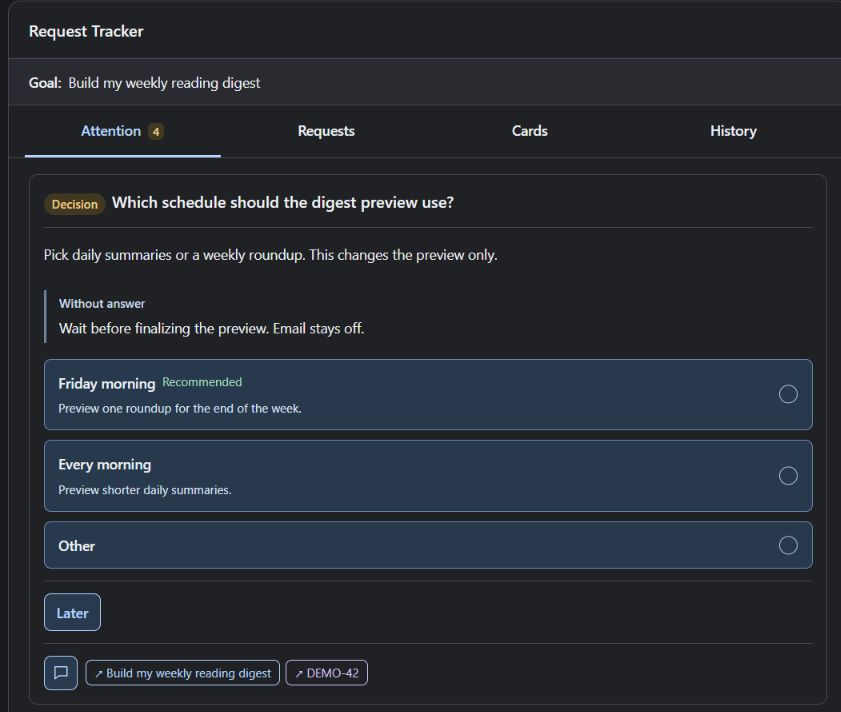

# Request Tracker

Request Tracker is a stateful Codex plugin that keeps requests and decisions visible as a conversation grows. See what is unfinished, answer the choices that need you, and find what you already agreed to without rereading the chat.

Ask for a weekly reading digest, detour into a broken inbox connection, then return to the schedule. The tracker keeps the digest as the same request, with its unanswered choice and the connection problem attached. The agent updates saved records as the work changes.

## Install

Try the [local demo](docs/install.md#try-without-installing), or follow the [installation guide](docs/install.md) to add the plugin to Codex. This repository is private; cloning it requires access. The guide covers prerequisites, updates, removal and an isolated installation check.

## Use

In a conversation, ask:

> Use Request Tracker in this conversation. Track my requests and unresolved choices.

The agent maintains the records. Use Attention to answer a question or review a result; Requests, Cards and History let you return to earlier work. You can reply in chat or select a card option and press **Send reply**. Selecting an option alone leaves a draft.

The [user guide](docs/guide.md) explains card actions, postponing a choice and acknowledging a notification. Tracking is enabled separately for each conversation. Completion still depends on evidence that the requested work was done.

## Storage

Records are local JSON files. Drafts use the host's webview storage, and submitted replies enter the current conversation. See [privacy and data removal](docs/privacy.md) for locations and retention.

## License

[MIT](LICENSE).
